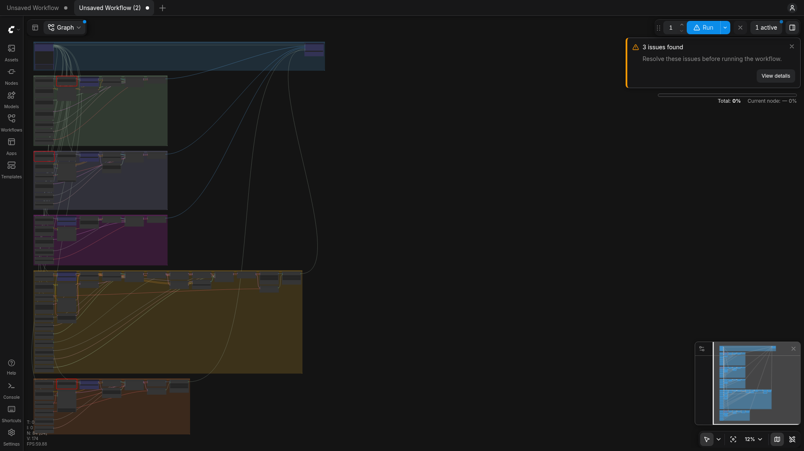

# Army of LoRAs for ComfyUI

**Type one prompt. ComfyUI decides whether it should be an image or a video, picks the best open model
for it (FLUX.2 [klein], Qwen-Image 2.1, MOSS-Image, LTX-2.3 or MiniMax H3), and drafts a squad of
community LoRAs from an army of 65, all in about 2 ms on the CPU, before any GPU work starts.**

There are thousands of great community LoRAs on Hugging Face and nobody can remember which one fits
which prompt, on which base model, at what strength, with which trigger word. Army of LoRAs makes that
choice for you inside ComfyUI using [pybed](https://github.com/lee101/pybed) static int8 embeddings,
then downloads and applies the chosen LoRAs on the fly.

- Demo video (2 min): `demo/army-of-loras-demo.mp4` (see [Demo](#demo))
- Try it online: **[ebank.nz art generator](https://ebank.nz)** and **[manifoldgen.com](https://manifoldgen.com)** run a
  similar pybed LoRA-routing system in production (our C inference server's `olora_route`, which this repo ports to ComfyUI)
- Try it locally: run ComfyUI with this node pack and open **`http://127.0.0.1:8188/army/studio`**
- Everything is SFW-only, and every LoRA is open-licensed or under its base model's community licence: [docs/CREDITS.md](docs/CREDITS.md)



## How it works

```
                prompt
                  |
          [SFW gate]  blocklist + pybed semantic check -> refuse
                  |
     pybed static int8 embedding (512-d, ~0.01 ms, CPU)
                  |
     +------------+-------------+
     | image or video?          |  prototype phrases + motion cues ("video", "drone shot", "turns into")
     +------------+-------------+
                  |
     score every LoRA in each candidate family's army:
        score = max cos(prompt, positive) - 0.5 * max cos(prompt, avoid) + 0.25 if a keyword hits
        (skipped if an exclude word hits, e.g. no style LoRA on lettering prompts)
                  |
     family fit = 0.5 * cos(prompt, family description) + 0.5 * mean(top-2 LoRA scores)
                  |  best family wins: the army decides which model gets deployed
     draft: best LoRA per group (style / look / format / motion / camera), score >= min_score,
            strength scaled by confidence, total strength capped per model
                  |
     prompt rewrite: prepend trigger words, add suffixes, merge negatives
                  |
     ARMY_PLAN -> ComfyUI graph: only the routed branch executes (lazy inputs)
```

**pybed** ([lee101/pybed](https://github.com/lee101/pybed), MIT) is a Python port of our gobed/cbed
static embedders: `static-retrieval-mrl-en-v1` quantised to int8 with a per-token scale and cut to
512 dimensions (16 MB, vendored in `embed_model/`). Embedding is a token-row gather plus a mean pool,
with no transformer forward pass, so scoring a prompt against all 225 LoRA description phrases takes 1-5 ms. The scoring rule is
the one we run in production in our C inference server (`olora_route.c`), extended here from "one LoRA"
to "a squad of LoRAs + which model to use".

**Lazy branch execution.** `army_auto.json` contains all five model pipelines. `ArmyAutoOutput` declares
one lazy input per family and its `check_lazy_status` only requests the family in the plan, so ComfyUI
never loads the other four models. One graph covers every image and video model.

### The nodes

| node | what it does |
|---|---|
| **Army of LoRAs: Router (pybed)** | prompt -> `ARMY_PLAN`, rewritten prompt, negative, family, is_video, report. Family can be `auto`, `auto_image`, `auto_video` or a fixed model. Shows the routing report on the node. |
| **Army of LoRAs: Apply Drafted LoRAs** | `MODEL` (+`CLIP`) + plan -> model with the drafted LoRAs. Downloads each LoRA from its author's HF repo on first use into `models/loras/army/`. Only acts when the plan routed to its `family`. |
| **Army of LoRAs: Auto Output** | output node with lazy `flux2_klein9b / qwen_image21 / moss` (IMAGE) and `ltx23 / h3` (VIDEO) inputs. Saves PNG or MP4 plus a `.plan.json` sidecar (the plan is also embedded in PNG metadata). |
| **Army of LoRAs: SFW Gate** | passes a prompt through, or stops the run if it is not SFW. |

HTTP routes added to the ComfyUI server: `/army/studio` (the one-page app), `/army/route?prompt=...`
(plan JSON), `/army/catalog`, `/army/workflow/<family|auto>` (API-format workflow).

### The army

| family | base model (speed-up) | mode | LoRAs |
|---|---|---|---|
| `flux2_klein9b` | FLUX.2 [klein] 9B fp8 (4-step distilled) | image | 30: pixel art, isometric, 3D render, claymation, amigurumi, coloring book, stickers, logos, emoji, album/book covers, blueprint, film looks... |
| `qwen_image21` | Qwen-Image 2.1 (Viggle 6-step turbo) | image | 8: film stills, grainscape, Y2K digicam, outrun, heatwave, clay, voxel, amethyst. Text/typography prompts land here and render without style LoRAs. |
| `moss` | MOSS-Image SFT int8 (rapid-moss 4-step adapter) | image | 10: gouache, psychedelic pop, impressionism, 3D animated, seinen anime, flat anime lineart, Kodachrome, grainscape, 1950s western / sci-fi |
| `ltx23` | LTX-2.3 22B distilled fp8, two-stage x2 upscale | video + audio | 7: transitions, human motion, fast-paced, surfaces realism, pixel art, googly eyes, audio-reactive |
| `h3` | MiniMax H3 int8 (lightx2v 4-step turbo) | video + audio | 10: low poly, 16-bit pixel, 70s retro toon, rough 2D cartoon, 1980s sci-fi / fantasy, 1950s western, handheld, FPV, human motion |

How the army was recruited: `tools/scrape_hf_loras.py` pulls every adapter on the Hub for each base
model (755 candidates), drops anything tagged not-for-all-audiences, anything whose id, card, trigger
or *file names* hit an adult / likeness / franchise blocklist, and anything without an open or
base-model community licence. That left 227. From those I read each model card by hand and kept 65
text-to-image/video style LoRAs (not edit/control LoRAs that need a reference image), with their real
trigger words and recommended strengths, in `tools/write_catalogs.py`. Each entry carries `positive` /
`avoid` descriptions, `keywords`, `exclude` words and a `group`, which is all the router needs.

Adding a LoRA is one entry in `tools/write_catalogs.py` + `python tools/write_catalogs.py`.

## Install and run locally

Tested on Linux, RTX 3090 Ti 24 GB, 64 GB RAM, ComfyUI master `b5a43215` (Oct 2026: needs a ComfyUI
recent enough to include MOSS-Image, Qwen-Image 2.1, LTX-2.3 and MiniMax H3 support).

```bash
# 1. ComfyUI
git clone https://github.com/comfyanonymous/ComfyUI && cd ComfyUI
uv venv -p 3.12 && uv pip install torch torchvision torchaudio --index-url https://download.pytorch.org/whl/cu128
uv pip install -r requirements.txt

# 2. this node pack (+ pybed) and the rapid-moss 4-step MOSS adapter node (Apache-2.0)
git clone https://github.com/lee101/army-of-loras-comfyui custom_nodes/army-of-loras-comfyui
uv pip install -r custom_nodes/army-of-loras-comfyui/requirements.txt
mkdir -p custom_nodes/rapid-moss && for f in __init__.py nodes.py; do
  curl -L -o custom_nodes/rapid-moss/$f https://huggingface.co/darask0/MOSS-Image_4-step_adapter_lora/resolve/main/comfyui/rapid-moss/$f; done

# 3. base models (pick the families you want; ~25-45 GB each). LoRAs download themselves on first use.
export HF_TOKEN=...   # FLUX.2 klein and some LoRAs are gated: accept their licences on huggingface.co first
custom_nodes/army-of-loras-comfyui/scripts/download_models.sh models flux qwen moss ltx h3

# 4. run, then open http://127.0.0.1:8188/army/studio or load a workflow from workflows/
.venv/bin/python main.py
```

If your model files have different names (other quantisations), put a `models.local.json` next to this
README mapping the keys in `tools/build_workflows.py:FILES` to your filenames. The Studio and
`scripts/run_prompt.py` pick it up, and `python tools/build_workflows.py --ui http://127.0.0.1:8188` regenerates
the UI workflows with them.

### Workflows

| file | contents |
|---|---|
| `workflows/army_auto.json` | router + all five model branches + auto output (image or video) |
| `workflows/army_flux2_klein9b.json`, `army_qwen_image21.json`, `army_moss.json` | one image model with the router fixed to it |
| `workflows/army_ltx23.json`, `army_h3.json` | one video model (with audio) |
| `workflows/api/*.json` | the same graphs in API format for `/prompt` |

Drag a UI workflow into ComfyUI, type a prompt into the Router node and queue. The Router node shows its
decision (mode, family scores, drafted LoRAs with scores and the phrase that matched, the bench, the
final prompt).

### Command line

```bash
python scripts/run_prompt.py "isometric diorama of a cozy wizard library"           # auto
python scripts/run_prompt.py --family h3 "16-bit pixel art video of a fox running"   # fixed model
python scripts/run_prompt.py --batch demo/prompts.txt --prefix demo                 # the demo set
```

### Tests

```bash
uv run --with pytest --with "pybed @ git+https://github.com/lee101/pybed" pytest   # no GPU needed
```

### Speed (RTX 3090 Ti, warm)

Routing: 1-5 ms per prompt on CPU. Generation times are in `demo/results.md` (written by
`demo/make_results.py` from the demo runs).

## Demo

`demo/army-of-loras-demo.mp4` is a 2-minute walkthrough built entirely from this repo's outputs. The
images and videos come from `demo/prompts.txt` run through `army_auto.json`, and the routing reports are
the real ones. The voiceover is generated with Kokoro-82M (Apache-2.0, via `kokoro-onnx`) and the video
is assembled with ffmpeg by `demo/make_video.py`.

## Tools and models combined

- **ComfyUI** (GPL-3.0): the whole pipeline is ComfyUI graphs and nodes.
- **pybed** (MIT): static int8 embeddings for routing; model vendored in `embed_model/`.
- **FLUX.2 [klein] 9B** (Black Forest Labs, FLUX non-commercial licence), **Qwen-Image 2.1** (Qwen Research
  licence, non-commercial), **MOSS-Image** (Apache-2.0), **LTX-2.3** (LTX-2 Community License),
  **MiniMax H3** (MiniMax H3 Community License).
- Speed-ups: FLUX.2 klein 9B distill LoRA, Viggle Qwen-Image 2.1 turbo LoRA, rapid-moss 4-step adapter
  (darask0, Apache-2.0), lightx2v H3 4-step turbo LoRA.
- 65 community LoRAs: see [docs/CREDITS.md](docs/CREDITS.md) for every author, repo, licence and trigger.
- Kokoro-82M TTS (Apache-2.0) for the demo voiceover; ffmpeg for assembly.

Model weights and LoRAs are downloaded from their authors and stay under their own licences. Several
are non-commercial; check them before commercial use.

## License

Code: MIT (see `LICENSE`). pybed model files in `embed_model/`: MIT (`embed_model/LICENSE-pybed`).
